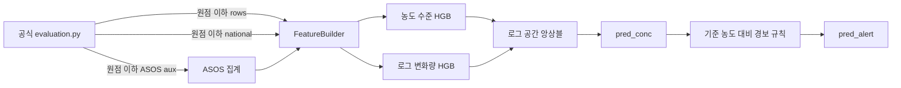

# 아키텍처

## 전체 흐름



공식 평가기는 각 평가 창마다 모델 객체를 새로 만들고 `fit`과 `predict`를 호출한다.
모델은 평가기가 전달한 데이터만 사용하며 원본 전체 패널을 직접 읽지 않는다.

## 구성 요소

| 파일 | 책임 |
|---|---|
| `src/model.py` | 두 회귀기 학습, 예측 앙상블, 경보 생성 |
| `src/feature_builder.py` | 지역별 이력 정렬, 시계열 특성 생성, 학습·예측 배열 구성 |
| `src/asos_features.py` | 공식 ASOS 일자료의 품질 검사와 시·도-주차 집계 |
| `scripts/analyze_data.py` | 데이터 구조·결측·이상치 프로파일 생성 |
| `scripts/analyze_errors.py` | 평가 창·지역별 회귀 오차 분석 |
| `scripts/build_submission.py` | 보고서·실행 코드·예측·자가 채점 결과 압축 |

## 학습 흐름

1. 공식 평가기가 `train_until`까지 잘라낸 패널·전국·ASOS 자료를 전달한다.
2. `aggregate_asos`가 관측소별 7일 완전성과 품질 플래그를 검사한 뒤 지역 주간값을 만든다.
3. `FeatureBuilder`가 지역별 이력을 주차순으로 정렬하고 동일한 특성 벡터를 생성한다.
4. 수준 모델은 `log1p(target_conc_t2)`를 학습한다.
5. 변화량 모델은 `log1p(target_conc_t2) - log1p(current_conc)`를 학습한다.

두 모델은 같은 전처리 파이프라인을 사용한다.

```text
SimpleImputer(strategy="median", add_indicator=True)
  -> HistGradientBoostingRegressor(
       learning_rate=0.04,
       max_iter=250,
       max_leaf_nodes=15,
       min_samples_leaf=20,
       l2_regularization=2.0,
       random_state=2026
     )
```

## 예측 흐름

1. 예측 원점까지 다시 잘린 자료로 특성을 생성한다.
2. 수준 모델 예측을 현재 농도와 로그 공간에서 50:50으로 결합한다.
3. 원점 이하 최근 3개 유효 농도의 안전한 후행 평균을 30% 반영한다.
4. 수준 결과 90%와 변화량 모델 결과 10%를 로그 공간에서 결합해 `pred_conc`를 만든다.
5. 예측 농도 80%와 현재 농도 20%의 기준 농도 대비 로그 비율이 `log(1.09)` 이상이면
   `pred_alert=1`로 반환한다.

## 누수 방지 경계

| 위험 | 처리 |
|---|---|
| 무작위 분할에서 미래 관측 혼입 | 시간 순서가 고정된 공식 롤링 창 사용 |
| 목표 시점 라벨 참조 | 평가기가 가린 빈 라벨은 학습 배열에서 제외 |
| 미래 ASOS 관측 참조 | 공식 `aux`로 전달된 원점 이하 일자료만 집계 |
| `conc_3wk_avg`의 알려진 미래 혼입 행 | 출력 계산에서 사용하지 않고 `conc_mean`으로 재계산 |
| 미래 시점 처리장 메타 | 모델 특성에서 제외 |
| 결측을 0으로 오인 | NaN 보존 후 학습 창 중앙값 대체, 결측 표시 특성 추가 |

## 의존성 방향

```text
model.py
├── feature_builder.py
├── asos_features.py
├── numpy
└── scikit-learn
```

핵심 제출 모델은 pandas나 실험용 LightGBM·CatBoost에 의존하지 않는다.
따라서 후보 실험 환경과 최종 실행 환경을 분리할 수 있다.
